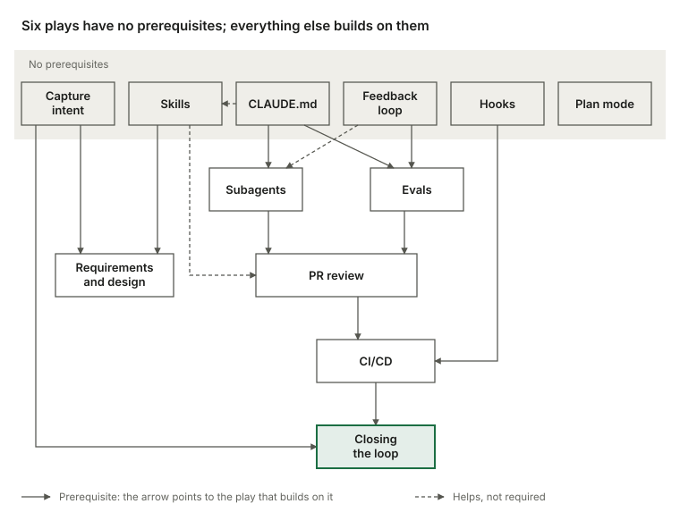

AI agents have changed how fast teams can write code. The process around that code has mostly stayed where it was.

Anthropic's Claude Academy recently published a course, *The AI-native SDLC playbook*, that starts from this gap. Its argument is that many engineering teams still run the same approval gates, reviews, handoffs and policies as before. Those gates stall the gains from agentic coding tools like Claude Code. These are my notes on the introduction, plus what I changed when I applied it to a small team.

> **TL;DR**
> - Agents made the build stage fast. Planning, review and release still run at human speed, so they are the new bottleneck.
> - The course keeps the old controls and enforces them differently: a committed artifact at every stage, and gates that fire automatically.
> - Six of the twelve plays have no prerequisites, so you can start small.
> - On a small team with no product owner, the same loop works if the developer who owns the work signs off on each artifact.

## The traditional SDLC was built around expensive code

The software development lifecycle (SDLC) is the process that takes software from idea to production. Most organizations run some version of six stages: plan, design, build, test, deploy and maintain. Each stage is a discrete phase owned by a different role. Product managers write requirements, architects turn them into designs, and engineers build. QA verifies (at regulated enterprises), release teams ship, and operations monitors what runs. Work moves between phases through documents, tickets and sign-offs.

The structure is process-heavy on purpose: it gives accountability and control at each step. It was also designed for an era when writing code was the slowest and most expensive stage. Product requirements documents, estimation rituals and product security reviews existed to force alignment across weeks, months or quarters of development. The controls also assume that a human performs every step.

## What changes when build runs at agent speed

Once the build phase runs faster than the traditional process allows for, the course points to three consequences:

1. The bottleneck moves. The slow points become the stages on either side of build: planning and review, testing and deploy. They still run at human speed.
2. Controls stop matching reality. Reviewing every line by hand made sense when a person wrote it. It can't keep up once agents write most of the diff.
3. Governance costs rise. Exceptions still route through meetings and committees that meet weekly or monthly.

The course uses security as its example. Security teams are sized for human output. When agents multiply code output, either the review queue grows or code ships under-reviewed. A regulated organization can accept neither outcome, so its security and policy checks have to keep pace with the agents.

The conclusion: to get the productivity gains of agentic AI securely, the rest of the lifecycle needs the same transformation the build phase has already gone through.

DORA, Google's long-running research program on software delivery, points the same way. Its 2025 report on AI-assisted development says AI's primary role is as an amplifier, [magnifying an organization's existing strengths and weaknesses](https://dora.dev/research/2025/dora-report/). It adds that the greatest returns come not from the tools themselves, but from a strategic focus on the underlying organizational system. That's a short statement, but it fits the course's claim: the tool is the easy part, and the process around it decides the result.

## The AI-native SDLC: a loop, not a line

The course keeps the old control objectives and changes how they are enforced. The linear flow becomes a continuous loop with AI embedded at every stage, and humans above the loop instigating, directing and governing. Handovers between stages are automated and trigger the next step, replacing the manual handoffs of the traditional model.

A committed artifact ties the loop together. Each stage ends by writing one to version control, and the next stage begins by reading it:

- `intent.md`, `spec.md` and `plan.md` in the early stages
- the diff and its tests
- the pull request with its review findings
- the incident record

In the early stages, Markdown files are the main artifact because a product owner and an agent can both read and act on the same file. From build onward, the artifact is code and its records. The chain of commits also becomes the audit trail: who asked for what, what the agent produced, and who approved it.

Humans remain accountable for every decision that requires judgment. Their attention moves to the artifacts that must be reviewed, at the gates.

## The shifts, stage by stage

Most organizations sit somewhere between the two columns.

| Stage | Traditional SDLC | AI-native SDLC |
| --- | --- | --- |
| Plan | Requirements gathered by committee, refined through workshops and sign-offs, written up by hand | Claude synthesizes pain points from the sources into `intent.md`, readable by humans and actionable by machines |
| Design | Specs written by analysts, then parsed by designers | Requirements and design compressed into one session with an agent, guided by standards encoded as skills and versioned in Git |
| Build | Handwritten code and tests, with documentation written afterward | AI-generated code and tests, with institutional knowledge kept in versioned `CLAUDE.md` files and skills |
| Test | QA gates at stage boundaries | Continuous evals woven through implementation |
| Deploy | Humans review every line, and governance happens in review cycles, often inconsistently | Layered agentic review, with human review reserved for regulated and critical code; governance enforced as the AI acts, with hooks as approval gates |
| Maintain | Humans watch production for bugs | Agents monitor live deployments; a breached control band is diagnosed and written back into the loop as a new `intent.md` |

## How the playbook is organized

The rest of the course is built from twelve "plays", grouped under the six stages. Each play covers what changes, how to get started, concrete implementation steps, governance considerations, and how to measure whether it worked. The plays are modular, so an organization can transform different stages at different times. Each one names its dependencies under "Prerequisites."

Solid arrows lead to a play that builds on the one at the tail. Dashed arrows mark a play that helps but is not required.

A stage ends by committing an artifact, and that commit starts the next stage:

- An accepted `intent.md` triggers the requirements and design pass.
- An approved `spec.md` triggers plan mode.
- A merged pull request triggers the pipeline.
- A breached control band in production writes the next `intent.md`, and the loop continues.

At first, you prompt each step by hand. The end state is a loop in which each accepted artifact fires the next gate. Human attention concentrates at those gates, reviewing what the agent flagged instead of starting each stage from scratch.

## What I changed for a small team

The course assumes a product owner who accepts `intent.md` and approves `spec.md`. On a small team, that person often doesn't exist for developer docs. A gate nobody staffs just stalls the loop.

So I'm turning the early plays into Claude Code skills for my own projects: `init`, `capture-intent`, `requirements-and-design` and `plan`. The biggest change is who approves. The developer who owns the work reviews each artifact and confirms it, and that confirmation is the only sign-off.

I kept the parts that make the artifacts useful:

- numbered requirements in `spec.md`, so the plan and the review can cite them
- flagged areas of concern, each with an owner who should decide
- a `plan.md` that names the files, the order of work, the risks and the tests

A small config file, written once by `init`, records where artifacts live and whether the intent comes from GitHub, Linear or Jira. I dropped what only matters at scale: the CI trigger on accepted intents, the escalation to a tech lead and the metrics.

Here's my opinion, not a result: the sign-off matters more than the role that gives it. A named person who confirms each artifact keeps the audit trail. A committee that nobody has time to convene doesn't.

## Takeaways

Faster code generation doesn't speed up delivery if planning, review and release still run at human speed. That's the claim from this introduction I'd bring to a team discussion.

The proposed fix keeps the same controls and enforces them differently: committed artifacts at every stage, gates that fire automatically, hooks that enforce policy as the agent acts, and layered agentic review with human attention reserved for regulated and critical code.

For teams that want to start, the dependency structure gives a clear entry point. Six plays have no prerequisites: capturing intent, `CLAUDE.md`, skills, a feedback loop, hooks and plan mode. Everything else builds on those.

## Sources

- [Introduction, The AI-native SDLC playbook, Claude Academy](https://academy.claude.com/courses/ai-native-sdlc-playbook/introduction), read November 2, 2026.
- [2025 DORA State of AI-assisted Software Development, overview](https://dora.dev/research/2025/dora-report/), read November 2, 2026.
